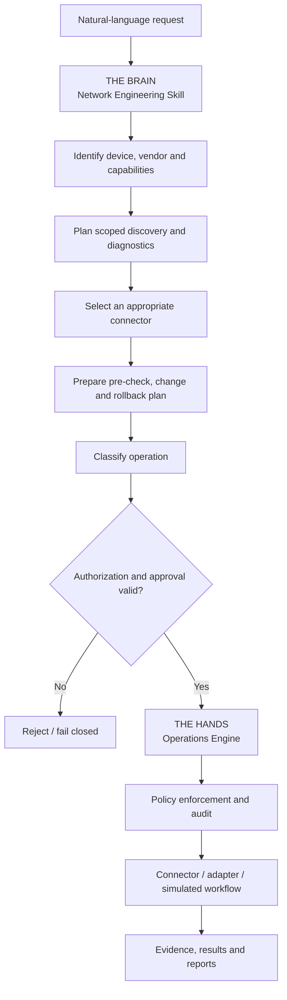

AI Network Operations Assistant
The Brain & The Hands
A vendor-aware network engineering assistant with a strict separation between operational reasoning and controlled execution.

  
  
  
  

Overview
The AI Network Operations Assistant combines network-engineering knowledge with a guarded software execution layer. Its design follows a simple principle:
The Brain decides what should happen. The Hands enforce what is allowed to happen.

The project uses a two-layer architecture:
Layer	Component	Responsibility
The Brain	SKILL.md, provisioning/, quality-control/, references/	Network knowledge, vendor guidance, troubleshooting methodology, SOPs, QC criteria, discovery methodology, and operational safety rules
The Hands	engine/, scripts/	Controlled execution paths, connectors, vendor adapters, policy enforcement, diagnostics, QC, topology processing, and report generation

The layers are designed to work together while remaining independently maintainable. The Skill provides operational reasoning; the Operations Engine applies execution and authorization controls.
Important: Current readiness
<blockquote>
<strong>This repository is a software release candidate for controlled development and lab evaluation. It is not production-ready for live network changes or provisioning.</strong>
</blockquote>Several integrations are deliberately simulation-only, unavailable, or fail-closed until trusted production providers and real-device validation are completed.
Area	Current status
Offline tests and simulated workflows	Implemented and covered by automated tests
Shared OperationsEngine workflow gateway	Used by all four module workflows when configured; module workflows remain simulated
Production authentication provider	Placeholder; rejects authentication
Trusted credential provider	Not bundled
External approval verifier for WRITE / CRITICAL	Not bundled
Live SNMP transport	Not implemented; fails closed
ACS / CWMP / USP and live provisioning	Mock/simulation only
Physical-router and hardware validation	Not verified
Windows-specific security and live Winbox behavior	Not verified
Continuous monitoring and alerting	Out of scope

Do not treat a passing mock test as proof of live-device compatibility. Do not enable live writes or critical changes until production identity, credential, and approval providers are integrated and independently validated.
Architecture

The Brain — Network Engineering Skill
The Skill provides the reasoning and operational rules used to:
- Identify device categories, capabilities, and firmware constraints.
- Plan scoped discovery and corroborate network adjacencies.
- Select an appropriate connector path, such as RouterOS API, SSH, or Winbox.
- Structure multi-stage operations with pre-checks, execution plans, and rollback considerations.
- Classify operations as READ_ONLY, DIAGNOSTIC, WRITE, or CRITICAL.
- Apply safety rules, credential-redaction requirements, and vendor-aware guidance.
The Hands — Operations Engine
The execution layer provides:
- A shared OperationsEngine workflow gateway.
- Authorization and policy enforcement.
- SSH and REST code paths, a fail-closed SNMP interface, and mock connectors.
- Vendor adapters and a conservative capability registry.
- Imported-evidence discovery and topology processing.
- On-demand analysis of supplied or mock measurements.
- QC evidence, decisions, session history, and report generation.
- Structured JSONL audit logging with secret redaction.
- A guarded Winbox integration wrapper whose live Windows behavior remains unverified.
Core modules
1. Advanced Network Operations
Provides network troubleshooting and operational workflows, supported by the shared policy and audit lifecycle.
- Vendor-aware troubleshooting guidance and evidence handling.
- Scoped, on-demand diagnostics.
- Connector-selection logic.
- Configuration planning with pre-check and rollback considerations.
- Live troubleshooting connectors remain disabled until trusted production providers are available.
2. ISP Provisioning & Remote Management
Provides reference material and simulated workflows for ISP access and subscriber-management scenarios.
- PPPoE / IPoE, BNG, VLAN, and QinQ workflow references.
- GPON / EPON / XGS-PON ONT and ONU guidance.
- TR-069 / CWMP and TR-369 / USP references.
- Remote-management security, RBAC, and credential-hygiene guidance.
- ACS and provisioning workflows are mock/simulation only; no live provisioning transport is bundled.
3. Advanced Device Quality Control
Provides model-aware QC workflows with evidence tracking and report generation.
- Device profiles and vendor-specific inspection criteria.
- Physical, power, Ethernet, wireless, and optical inspection categories.
- Evidence references and provenance retention.
- Mandatory-check blocking and missing-evidence detection.
- QC history and retest records.
- JSON, CSV, and PDF reporting; XLSX output is available when openpyxl is installed.
A PASS for mandatory checks requires validated evidence or a distinct manual attestation. A submitted value alone should not be treated as independently verified evidence.
4. Network Discovery & Topology Mapping
Processes imported or mock Layer 2 and Layer 3 neighbor evidence into confidence-labelled topology graphs.

Supported evidence formats and sources include:
- MikroTik RouterOS MNDP / LLDP output.
- Cisco IOS / IOS-XE CDP neighbor output.
- IEEE 802.1AB LLDP output from supported vendor environments.
- Bridge Host / FDB forwarding tables and DHCP lease evidence.
Topology confidence labels:
Label	Meaning
VERIFIED	Bidirectional adjacency corroborated from both endpoints
INFERRED	Unidirectional neighbor observation or switch access-port correlation
UNKNOWN	Uncorroborated host hint or conflicting bridge-port records

The topology engine does not create links based only on shared IP subnets. It can export SVG and a self-contained HTML evidence viewer; network-derived text is escaped.

The current release does not include a live LLDP/CDP/MNDP/SNMP collector, live subnet scanning, or physical-link validation.
Permission and execution model
Every operation must declare its classification before execution.
Classification	Intended scope	Approval / safeguard
READ_ONLY	Explicitly allowlisted reads and offline evidence inspection	Authenticated context and device scope; live use additionally requires production identity and credentials
DIAGNOSTIC	Scoped, bounded, on-demand diagnostics	Explicit diagnostic scope; live use requires trusted production identity and credentials
WRITE	Configuration changes	External approval bound to requester, canonical target, exact diff, and expiry
CRITICAL	High-impact changes	External exact-diff approval with two distinct approvers, separate from the requester

Security controls
- Production authentication is not available in this distribution; ProdAuthProvider is a placeholder and rejects authentication.
- Development identities default to READ_ONLY.
- DIAGNOSTIC requires explicit AGY_DEV_DIAGNOSTIC=1 opt-in.
- Development identities cannot receive WRITE or CRITICAL.
- No trusted credential provider is bundled.
- WRITE and CRITICAL require an external approval verifier; no verifier is bundled.
- SSH rejects unknown host keys and blocks shell operators.
- REST requires HTTPS certificate validation and same-host relative endpoints.
- Live SNMP transport is not implemented and fails closed.
- Winbox live sessions require verified context, a canonical inventory target, and a trusted credential provider. Simulated targets cannot be opened as live sessions.
- Troubleshooting evidence encryption uses AES-GCM. Windows DPAPI/ACL integration is not verified; non-Windows development key protection is explicitly insecure, and production storage fails closed.
- Audit output uses JSONL with secret redaction.
Repository structure
network-engineering/
├── SKILL.md
├── README.md
├── .agents/
│   └── skills/network-engineering/
├── .claude/
│   └── skills/network-engineering/
├── engine/
│   ├── discovery/          # Imported-evidence discovery and neighbor parsers
│   ├── topology/           # Topology graph and SVG/HTML visualizers
│   ├── health/             # On-demand analysis of supplied/mock measurements
│   ├── winbox/             # Winbox desktop integration wrapper
│   ├── connectors/         # SSH, REST, SNMP interface, and mock connectors
│   ├── adapters/           # Vendor adapters and capability registry
│   ├── policy/             # Policy, identity context, and audit logging
│   ├── execution/          # OperationsEngine orchestration
│   ├── inventory/          # Device inventory
│   └── cli/                # NetOps CLI
├── provisioning/
│   ├── pppoe/
│   ├── ont-onu/
│   ├── tr-069/
│   ├── tr-369/
│   ├── remote-management/
│   └── playbooks/
├── quality-control/
│   ├── profiles/
│   ├── vendor-checklists/
│   ├── history/
│   └── reports/
├── scripts/
│   ├── qc_engine/
│   ├── acs_integration/
│   └── redact.py
└── tests/
Getting started
Requirements
- Python 3.10 or newer.
- pip.
- Git, if cloning the repository.
- Dependencies listed in requirements-dev.txt to run the complete development test suite.
Install
git clone https://github.com/Sainz11/network-engineering-skill.git
cd network-engineering-skill

python -m venv .venv
Activate the virtual environment:

Windows PowerShell
.\.venv\Scripts\Activate.ps1
Linux / macOS
source .venv/bin/activate
Install development dependencies:
python -m pip install --upgrade pip
python -m pip install -r requirements-dev.txt
If PowerShell blocks virtual-environment activation because of the execution policy, use an approved local environment setup method or run the commands from Command Prompt. Do not change system-wide security settings just to activate the environment.

Usage examples
The examples below demonstrate the repository's current simulated/offline workflows. They do not establish live-device connectivity.
1. Build a topology from mock evidence
from engine.discovery import DiscoveryCollector
from engine.topology import TopologyEngine, TopologyVisualizer
from engine.health import NetworkHealthAnalyzer

collector = DiscoveryCollector(
    authorized_subnets=["10.0.0.0/16"]
)

discovered_devices = collector.discover_from_mock_environment()

topology = TopologyEngine()
devices, links = topology.build_topology(discovered_devices)

topology_data = topology.export_topology_data()
visualizer = TopologyVisualizer(topology_data)

visualizer.generate_svg("quality-control/reports/topology.svg")
visualizer.generate_html_viewer(
    "quality-control/reports/topology.html"
)

health_summary = NetworkHealthAnalyzer.generate_health_summary(
    discovered_devices
)

print("Overall Network Health:", health_summary["overall_health"])
2. Inspect device inventory
python engine/cli/netops_cli.py inventory
3. Inspect simulated device system information
python engine/cli/netops_cli.py exec \
  --device RTR-CORE-01 \
  --action system_info \
  --mode SIMULATED
4. Run a QC session
from scripts.qc_engine import (
    QCTestEngine,
    DeviceIdentity,
    QCReportGenerator,
)

engine = QCTestEngine()

device = DeviceIdentity(
    manufacturer="MikroTik",
    model="RB750Gr3",
    serial_number="HE0912837",
)

measurements = {
    "PHYS-01": {"value": "PASS", "evidence_ref": "photo_bench.jpg"},
    "PHYS-02": {"value": "PASS", "evidence_ref": "ports_checked.jpg"},
    "PHYS-03": {"value": "PASS", "evidence_ref": "label.jpg"},
    "PWR-01": {"value": "PASS", "evidence_ref": "boot.log"},
    "PWR-02": {"value": "PASS", "evidence_ref": "leds.jpg"},
    "ETH-01": {"value": "1000M", "evidence_ref": "negotiation.txt"},
    "ETH-02": {"value": "PASS", "evidence_ref": "counters.txt"},
}

report = engine.run_qc_session(
    device,
    measurements,
    technician="NOC_Tech_01",
)

print("Final QC Status:", report.final_status.value)
Testing
Install the development dependencies, then run:
python -m compileall -q engine scripts tests
python -m pytest -q -rs
The automated test suite covers:
- Discovery and topology: imported/mock evidence parsing, neighbor parsers, bidirectional corroboration, SVG/HTML escaping, and on-demand health analysis.
- Winbox wrapper: process detection, installation-path resolution, GUI-launch logic, UI automation helpers, evidence screenshot recording, and connector selection. Live Windows behavior remains unverified.
- Operations Engine and policy: operation classification, fail-closed approval checks, exact-diff binding, simulated module workflows, and structured audit logging.
- Device QC: model-aware thresholds, mandatory-check blocking, missing-evidence detection, and report generation.
- ACS / CWMP: mock-only workflows and provisioning simulations.
- Security: secret-redaction behavior and relevant policy safeguards.
- Real-router validation: a dedicated optional test path. If LAB_MIKROTIK_IP is not configured, the hardware test is skipped and must be reported as NOT VERIFIED.
For the release-specific verification record, see [`FINAL_VERIFICATION.md`](FINAL_VERIFICATION.md).
Documentation and audit references
- [`SKILL.md`](SKILL.md) — canonical Skill instructions.
- [`MODULES.md`](MODULES.md) — module coverage and status.
- [`AUDIT_AND_IMPLEMENTATION_PLAN.md`](AUDIT_AND_IMPLEMENTATION_PLAN.md) — audit and implementation tracking.
- [`FINAL_VERIFICATION.md`](FINAL_VERIFICATION.md) — release-candidate verification record.
Scope boundaries
This project focuses on on-demand network engineering workflows. It does not provide:
- Continuous monitoring or background polling.
- Scheduled telemetry collection or automatic alerting.
- A bundled production identity, credential-vault, or approval service.
- Verified live SNMP, ACS/CWMP/USP, or subscriber provisioning transport.
- A guarantee of compatibility with physical devices based only on simulated tests.
Contributing
Contributions should preserve the separation between the Brain and the Hands, maintain fail-closed behavior, and include regression tests for changes to authorization, connector selection, evidence handling, or execution workflows.

Before submitting changes:
1. Keep operational claims aligned with implemented and verified behavior.
2. Add or update tests for changed behavior.
3. Run the compile and test commands above.
4. Document any live-integration or hardware-validation requirement that remains outstanding.
License
No license information was present in the supplied README content. Add a LICENSE file and update this section before describing the project as open source or granting reuse rights.
