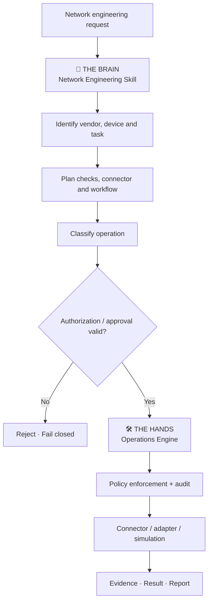

⚡ AI Network Operations Assistant
THE BRAIN × THE HANDS
A vendor-aware Network Engineering Skill and controlled Operations Engine.

Plan network operations with engineering knowledge. Execute only through explicit policy, authorization, and evidence controls.

  
  
  
  
  

Overview · Features · Install · Usage · Security · Tests

🧭 Overview
AI Network Operations Assistant is a two-layer network engineering project. It separates the AI's operational knowledge from the software that enforces execution rules.
THE BRAIN decides what should happen. THE HANDS enforce what is allowed to happen.

Layer	What it contains	What it does
🧠 THE BRAIN	SKILL.md, provisioning/, quality-control/, references and playbooks	Vendor-aware reasoning, technical SOPs, troubleshooting, QC criteria, discovery methodology, and safety rules
🛠️ THE HANDS	engine/, scripts/	Operations gateway, policy enforcement, connector code paths, adapters, simulated workflows, evidence handling, and reports

The repository includes Skill mirrors for OpenAI Codex and Claude Code. Install the Skill into an agent to make its network-engineering instructions available. The Operations Engine is a separate software component: installing the Skill does not automatically connect an AI agent to routers, credentials, or local execution tools.
✨ Core modules
<table>
<tr>
<td width="50%" valign="top">01 · Advanced Network Operations
- Vendor-aware troubleshooting guidance
- Scoped, on-demand diagnostics
- Connector-selection logic
- Configuration planning
- Pre-check and rollback considerations
</td>
<td width="50%" valign="top">02 · ISP Provisioning & Remote Management
- PPPoE / IPoE, BNG, VLAN and QinQ references
- GPON / EPON / XGS-PON ONT/ONU guidance
- TR-069 / CWMP and TR-369 / USP references
- Remote-management security and credential hygiene
- Simulated provisioning workflows
</td>
</tr>
<tr>
<td width="50%" valign="top">03 · Advanced Device Quality Control
- Model-aware device profiles
- Physical, power, Ethernet, wireless and optical checks
- Evidence references and provenance
- Mandatory-check blocking
- QC history and retest records
- JSON, CSV, PDF and optional XLSX reports
</td>
<td width="50%" valign="top">04 · Network Discovery & Topology Mapping
- Imported/mock LLDP, CDP and MNDP evidence
- Layer 2 / Layer 3 neighbor parsing
- VERIFIED, INFERRED, UNKNOWN confidence labels
- Evidence-backed topology graph
- SVG and self-contained HTML exports
- No link creation from shared subnet alone
</td>
</tr>
</table>🏗️ Architecture

Operation lifecycle
1. Understand the request and identify the target scope.
2. Determine the required operation classification.
3. Validate identity, permissions, target, and any required approval.
4. Execute only through the configured and permitted workflow.
5. Record results and evidence in the audit lifecycle.
📦 Installation
Choose the AI coding agent you use. The repository contains the Skill folders for both supported local installation paths.
1. Requirements
- Git
- Python 3.10+
- OpenAI Codex or Claude Code for agent-based Skill usage
- PowerShell on Windows, or a terminal on Linux/macOS
2. Clone the repository
git clone https://github.com/Sainz11/network-engineering-skill.git
cd network-engineering-skill
The repository contains these Skill locations:
.agents/skills/network-engineering/   # OpenAI Codex
.claude/skills/network-engineering/   # Claude Code
3A. Install for OpenAI Codex
Option A — Project installation (recommended)

If you open Codex with this repository as the project, the Skill is already in the repository-level .agents/skills/ location. Start Codex from the repository root:
cd path\to\network-engineering-skill
codex
Codex scans repository-level .agents/skills/ folders. In Codex, use /skills to inspect available Skills or mention the Skill using $ if it appears in the selector.

Option B — Install for all your projects (Windows PowerShell)

Run from the cloned repository root:
$destination = Join-Path $HOME ".agents\skills\network-engineering"

if (Test-Path $destination) {
    Write-Host "Skill already exists at: $destination" -ForegroundColor Yellow
    Write-Host "Back it up or choose a different destination before installing."
} else {
    New-Item -ItemType Directory -Force -Path (Split-Path $destination) | Out-Null
    Copy-Item ".agents\skills\network-engineering" $destination -Recurse
    Write-Host "Installed Codex Skill to: $destination" -ForegroundColor Green
}
Linux / macOS

Run from the cloned repository root:
mkdir -p "$HOME/.agents/skills"
cp -R ".agents/skills/network-engineering" "$HOME/.agents/skills/"
Restart Codex if the Skill does not appear after installation.
3B. Install for Claude Code
Option A — Project installation (recommended)

Open Claude Code from the repository root. The project Skill is already located under .claude/skills/:
cd path\to\network-engineering-skill
claude
Claude Code discovers project Skills from .claude/skills/. The Skill can be invoked as /network-engineering when its directory/frontmatter name is network-engineering.

Option B — Install for all your projects (Windows PowerShell)

Run from the cloned repository root:
$destination = Join-Path $HOME ".claude\skills\network-engineering"

if (Test-Path $destination) {
    Write-Host "Skill already exists at: $destination" -ForegroundColor Yellow
    Write-Host "Back it up or choose a different destination before installing."
} else {
    New-Item -ItemType Directory -Force -Path (Split-Path $destination) | Out-Null
    Copy-Item ".claude\skills\network-engineering" $destination -Recurse
    Write-Host "Installed Claude Code Skill to: $destination" -ForegroundColor Green
}
Linux / macOS

Run from the cloned repository root:
mkdir -p "$HOME/.claude/skills"
cp -R ".claude/skills/network-engineering" "$HOME/.claude/skills/"
Restart Claude Code if the Skill does not appear. Invoke it with:
/network-engineering
4. Verify the Skill files
The Skill directory must contain SKILL.md at its root. Check both repository mirrors:

Windows PowerShell
Test-Path ".agents\skills\network-engineering\SKILL.md"
Test-Path ".claude\skills\network-engineering\SKILL.md"
A result of True means the corresponding file exists in that location. It does not by itself verify that the agent loaded the Skill or that operational tools are connected.
5. Install Python dependencies (for the Operations Engine)
Installing the Skill and installing the Python project are separate steps. If you also want to run the repository's local code and tests:
python -m venv .venv
.\.venv\Scripts\Activate.ps1
python -m pip install --upgrade pip
python -m pip install -r requirements-dev.txt
Linux / macOS activation:
python3 -m venv .venv
source .venv/bin/activate
python -m pip install --upgrade pip
python -m pip install -r requirements-dev.txt
PowerShell note: If activation is blocked by your machine's execution policy, use Command Prompt or an approved local Python environment workflow. Avoid changing system-wide security settings just to activate the environment.

🚀 Quick start
These examples use the current simulated/offline workflows. They do not establish live-device connectivity.
Inspect inventory
python engine/cli/netops_cli.py inventory
Run a simulated read-only system-info action
python engine/cli/netops_cli.py exec --device RTR-CORE-01 --action system_info --mode SIMULATED
Build a topology from mock evidence
from engine.discovery import DiscoveryCollector
from engine.topology import TopologyEngine, TopologyVisualizer

collector = DiscoveryCollector(
    authorized_subnets=["10.0.0.0/16"]
)

discovered_devices = collector.discover_from_mock_environment()

topology = TopologyEngine()
devices, links = topology.build_topology(discovered_devices)

visualizer = TopologyVisualizer(topology.export_topology_data())
visualizer.generate_svg("quality-control/reports/topology.svg")
visualizer.generate_html_viewer("quality-control/reports/topology.html")
Run a QC session
from scripts.qc_engine import QCTestEngine, DeviceIdentity

engine = QCTestEngine()

device = DeviceIdentity(
    manufacturer="MikroTik",
    model="RB750Gr3",
    serial_number="HE0912837",
)

measurements = {
    "PHYS-01": {"value": "PASS", "evidence_ref": "photo_bench.jpg"},
    "PHYS-02": {"value": "PASS", "evidence_ref": "ports_checked.jpg"},
    "PHYS-03": {"value": "PASS", "evidence_ref": "label.jpg"},
    "PWR-01": {"value": "PASS", "evidence_ref": "boot.log"},
    "PWR-02": {"value": "PASS", "evidence_ref": "leds.jpg"},
    "ETH-01": {"value": "1000M", "evidence_ref": "negotiation.txt"},
    "ETH-02": {"value": "PASS", "evidence_ref": "counters.txt"},
}

report = engine.run_qc_session(
    device,
    measurements,
    technician="NOC_Tech_01",
)

print(report.final_status.value)
🔐 Security model
Every operation declares its classification before execution.
Classification	Scope	Required safeguards
READ_ONLY	Allowlisted reads and offline evidence inspection	Authenticated context and device scope; live use also needs production identity and credentials
DIAGNOSTIC	Scoped, bounded, on-demand diagnostics	Explicit diagnostic scope; live use needs trusted production identity and credentials
WRITE	Configuration changes	External approval bound to requester, canonical target, exact diff, and expiry
CRITICAL	High-impact changes	External exact-diff approval from two distinct approvers, separate from requester

Current security boundaries
- ProdAuthProvider is a placeholder and rejects authentication.
- Development identities default to READ_ONLY.
- DIAGNOSTIC requires explicit AGY_DEV_DIAGNOSTIC=1 opt-in.
- Development identities cannot receive WRITE or CRITICAL.
- No trusted production credential provider is bundled.
- No external approval verifier is bundled; live WRITE and CRITICAL operations are therefore unavailable.
- SSH rejects unknown host keys and blocks shell operators.
- REST requires HTTPS certificate validation and same-host relative endpoints.
- Live SNMP transport is not implemented and fails closed.
- Winbox live behavior and Windows-specific security integration are not verified.
- AES-GCM is used for troubleshooting evidence encryption; Windows DPAPI/ACL integration is not verified. Non-Windows development key protection is explicitly insecure, and production storage fails closed.
📁 Repository structure
network-engineering-skill/
├── SKILL.md
├── README.md
├── .agents/
│   └── skills/network-engineering/    # Codex Skill mirror
├── .claude/
│   └── skills/network-engineering/    # Claude Code Skill mirror
├── engine/
│   ├── discovery/
│   ├── topology/
│   ├── health/
│   ├── winbox/
│   ├── connectors/
│   ├── adapters/
│   ├── policy/
│   ├── execution/
│   ├── inventory/
│   └── cli/
├── provisioning/
│   ├── pppoe/
│   ├── ont-onu/
│   ├── tr-069/
│   ├── tr-369/
│   ├── remote-management/
│   └── playbooks/
├── quality-control/
│   ├── profiles/
│   ├── vendor-checklists/
│   ├── history/
│   └── reports/
├── scripts/
│   ├── qc_engine/
│   ├── acs_integration/
│   └── redact.py
└── tests/
🧪 Testing
Install the development dependencies first, then run:
python -m compileall -q engine scripts tests
python -m pytest -q -rs
The automated suite covers imported/mock discovery evidence, topology parsing and exports, Winbox wrapper logic, Operations Engine policy workflows, QC validation and reports, mock ACS workflows, and security/secret-redaction behavior.

The optional real-router test is skipped when LAB_MIKROTIK_IP is not configured. A skipped hardware test means NOT VERIFIED, not passed hardware validation.

For the release-specific record, see [`FINAL_VERIFICATION.md`](FINAL_VERIFICATION.md).
🧩 What installation does — and does not do
Installing the Skill gives the agent…	It does not automatically give the agent…
Network-engineering instructions and SOPs	Router credentials
Vendor-aware troubleshooting guidance	Access to your local network
QC and discovery methodology	A live SSH / API / SNMP connection
Permission and safety rules	Permission to change device configuration
References to project workflows	A running Operations Engine or MCP server

The Skill is the knowledge layer. The Operations Engine and any trusted connector/provider are the execution layer. They must be configured and authorized separately.
🧯 Troubleshooting

<strong>Codex does not show the Skill</strong>
- Confirm the folder is under .agents/skills/network-engineering/.
- Confirm SKILL.md exists directly inside that folder.
- Open Codex from the repository root for project-level discovery.
- Run /skills and restart Codex if necessary.
- For global installation, confirm the destination is $HOME/.agents/skills/network-engineering/.

<strong>Claude Code does not show /network-engineering</strong>
- Confirm the folder is under .claude/skills/network-engineering/.
- Confirm SKILL.md exists directly inside that folder.
- Confirm the Skill's frontmatter and directory name are valid.
- Restart Claude Code.
- For global installation, confirm the destination is $HOME/.claude/skills/network-engineering/.

<strong>The agent knows the Skill but cannot connect to a router</strong>
That is expected with the current release configuration. Installing a Skill does not install credentials, a production identity provider, an approval verifier, or a live connector. Current workflows are simulation/offline unless a separately validated integration is configured.

<strong>Python reports a missing module</strong>

Activate the project's virtual environment and install the dependencies:
python -m pip install -r requirements-dev.txt

📚 Documentation
- [`SKILL.md`](SKILL.md) — canonical Skill instructions.
- [`MODULES.md`](MODULES.md) — module coverage and status.
- [`AUDIT_AND_IMPLEMENTATION_PLAN.md`](AUDIT_AND_IMPLEMENTATION_PLAN.md) — audit and implementation tracking.
- [`FINAL_VERIFICATION.md`](FINAL_VERIFICATION.md) — release-candidate verification record.
🚧 Scope and roadmap boundaries
This project focuses on on-demand network engineering workflows. Continuous monitoring, background polling, scheduled telemetry, and automatic alerting are intentionally out of scope.

The following integrations remain unverified or unavailable in this release:
- Production authentication, credential-vault, and external approval providers.
- Live SNMP transport.
- Production ACS / CWMP / USP and subscriber provisioning transport.
- Live device discovery and physical-link validation.
- Windows-specific security behavior and live Winbox sessions.
- Physical-router and hardware validation.
🤝 Contributing
Contributions should preserve the Brain/Hands separation and fail-closed security model.
1. Keep README claims aligned with implemented and verified behavior.
2. Add regression tests for changes to authorization, connectors, evidence handling, and execution workflows.
3. Run the compile and test commands above.
4. Document any integration or hardware validation that remains outstanding.
📄 License
No license file was identified in the supplied README. Add a LICENSE file before presenting this repository as open source or granting reuse rights.

THE BRAIN plans. THE HANDS enforce. Every operation stays within its authorization boundary.

